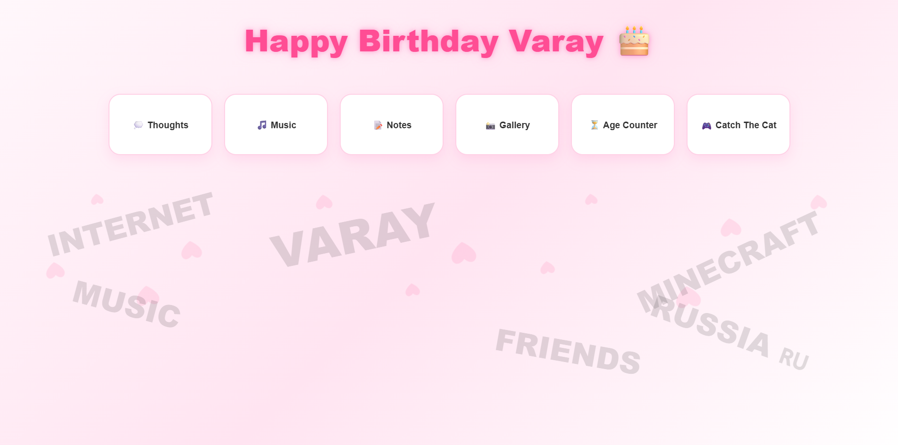
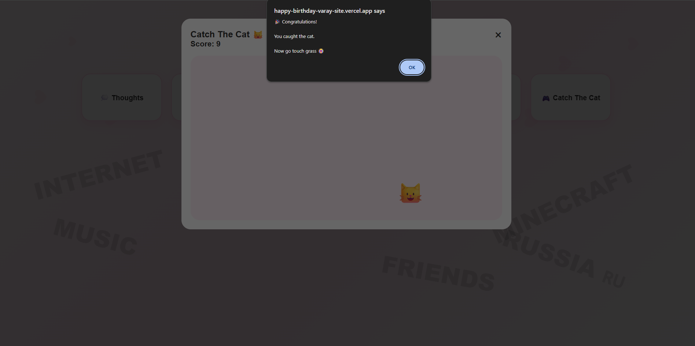

# Birthday Surprise Website

An interactive birthday website made as a personal gift for a friend. It opens with a secret-code screen, then reveals a colourful home page with six interactive sections: written thoughts, a music list, notes, a photo gallery, a live age counter and a small mini-game. It runs entirely in the browser, with no frameworks, no libraries and no server.

**Live demo:** https://happy-birthday-varay-site.vercel.app/





## Why I built it

I wanted a project that was both personal and technical. A gift website let me practise real front-end skills (page structure, animation, responsive design and JavaScript logic) while building something that someone would actually enjoy using. I deliberately wrote everything by hand, without frameworks or libraries, so that I understand every part of the code.

## Features

- **Secret-code entry screen** that only shows the main page when the correct code is typed, and displays a friendly error message otherwise
- **Home page with six interactive cards** that fade in one after another
- **Pop-up windows (modals)** for every section, which can be closed with the close button or by clicking outside the window
- **Thoughts:** short written stories and messages, with an image
- **Music:** a list of songs, each linking to YouTube in a new tab
- **Notes:** a list of friendly reminders
- **Gallery:** a responsive photo grid with a zoom effect on hover
- **Age counter:** shows the exact age in years, months and days, plus the total hours and minutes lived, and updates automatically every minute
- **Catch the Cat mini-game:** click the cat as it jumps to random positions; the score is counted, and reaching 10 shows a congratulations message and restarts the game
- **Animated floating hearts** in the background, made with CSS only
- **Responsive layout** that adapts to phones, tablets and desktops

## Built with

- **HTML5** for the page structure
- **CSS3** (Flexbox, Grid, keyframe animations, transitions, pseudo-elements, media queries)
- **JavaScript (ES6)** with no frameworks or external libraries: DOM manipulation, events, the Date object, timers, template literals and random numbers
- **Vercel** for hosting
- **Git and GitHub** for version control

## How to use

1. Open the live demo link above (or open `index.html` in any browser).
2. Enter the secret code and press **Enter**.
3. Click any card on the home page to open its section.
4. Close a section with the **×** button or by clicking outside it.
5. Open **Catch The Cat** and click the cat as fast as you can. Catch it 10 times to win.

## Project structure

```
happy-birthday-varay-site/
├── index.html           # Page structure: login screen, home cards and all section windows
├── style.css            # Styling, animations and responsive layout
├── script.js            # Login check, modals, age counter and the mini-game
├── images/              # Pictures used in the gallery and the thoughts section
├── screenshot.png       # Screenshot of the home page, shown in this README
├── screenshot-game.png  # Screenshot of the mini-game, shown in this README
└── README.md            # Project description
```

## How it works

- **Login:** the typed code is compared with the correct code in JavaScript. If it matches, the login screen is hidden and the main page is shown; if not, an error message appears. This is a playful gate for a surprise, not real security, because the check runs in the browser.
- **Modals:** each section is a hidden full-screen overlay. `openModal(id)` and `closeModal(id)` toggle its display, and a click on the dark background also closes it.
- **Age counter:** the birth date is subtracted from the current date to get years, months and days. When the day or month difference is negative, the code borrows from the previous month or year. The total hours and minutes come from the difference in milliseconds. A timer refreshes the numbers every 60 seconds.
- **Mini-game:** the cat is an absolutely positioned element. Each click increases the score and moves the cat to a new random position using `Math.random()`. At 10 points the score is reset.
- **Animations:** the cards use a staggered fade-up animation, the modals pop in with a scale animation, and the hearts float up the screen with a looping CSS animation.

## What I learned

- Structuring a multi-section interface and showing or hiding parts of the page with JavaScript
- Building reusable pop-up windows and handling clicks inside and outside them
- Working with dates: calculating exact age and handling negative day and month differences
- Using timers (`setInterval`) to keep information up to date
- Creating animations with CSS keyframes, transitions and pseudo-elements
- Building a responsive layout with Flexbox, Grid (`auto-fit`) and media queries
- Making a small interactive game with random positioning and a score
- Publishing a project with GitHub and Vercel

## Possible improvements

- Move the secret-code check to a server so the content is truly protected
- Add background music with a play and pause button
- Add more mini-games or a high-score list
- Add a language switch (English and Arabic)
- Add keyboard support and screen-reader labels for the cards and pop-up windows

## Author

**Osama Mohamed Gamal**
GitHub: [osamamohamedgamal57-star](https://github.com/osamamohamedgamal57-star)
